# AAA Engine — Sequence Flows

**Version:** 1.0.0
**Date:** November 11, 2026
**Author:** Surya (AAA Core Lead)

---

## 1. Enrollment Flow

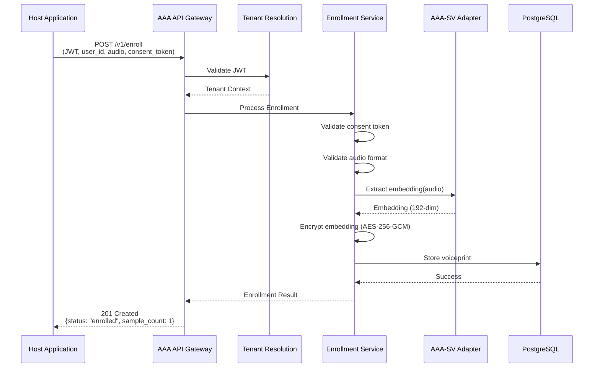

---

## 2. Challenge Generation Flow

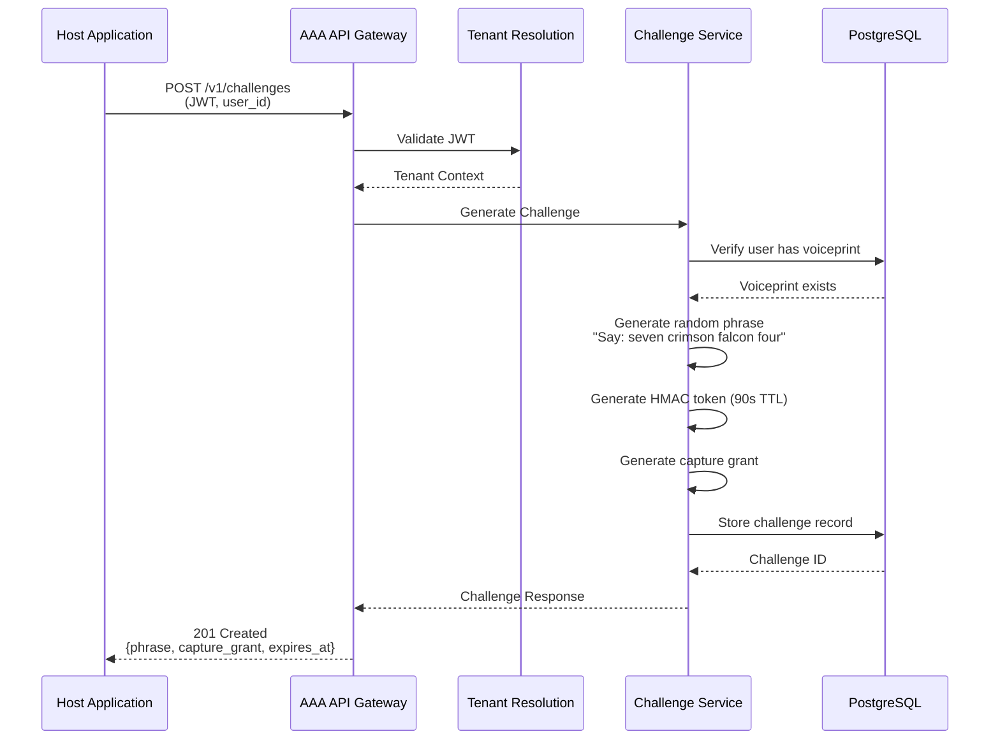

---

## 3. Verification Flow (Success)

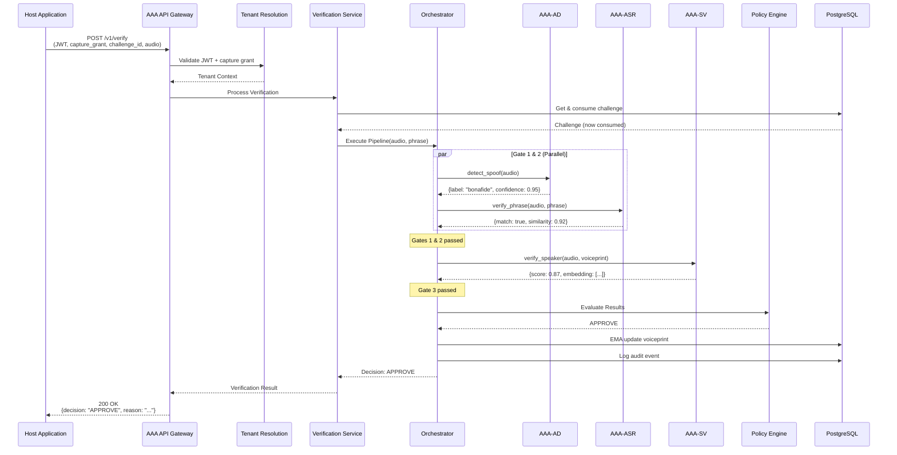

---

## 4. Verification Flow (Denial - Deepfake Detected)

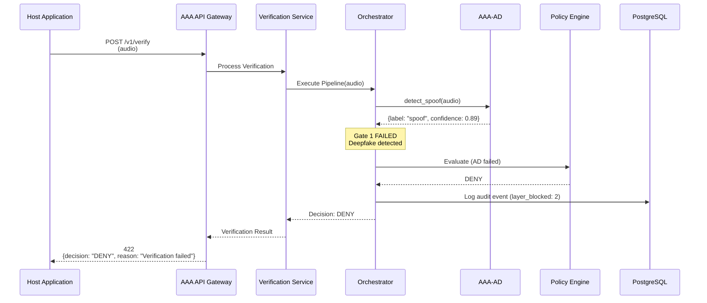

---

## 5. Verification Flow (Denial - Phrase Mismatch)

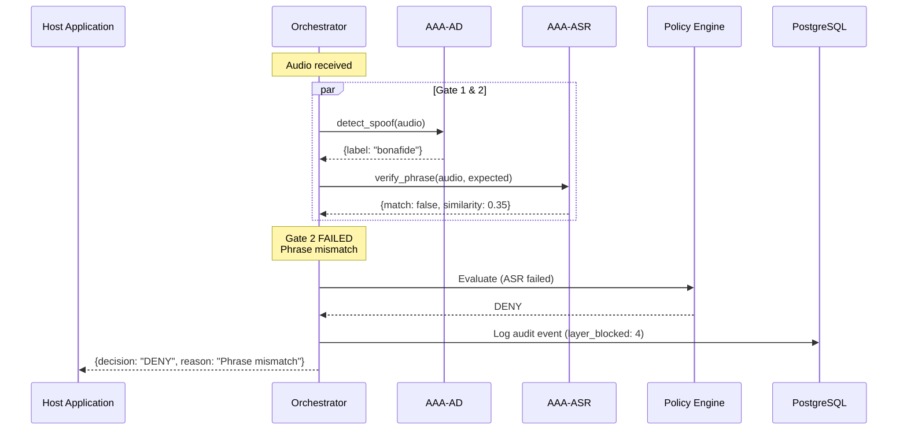

---

## 6. Verification Flow (Denial - Speaker Mismatch)

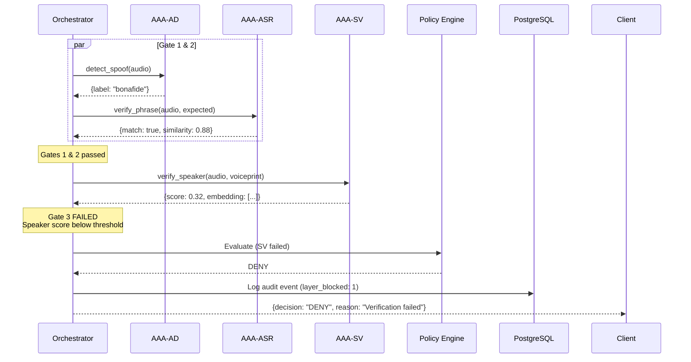

---

## 7. Token Validation Flow

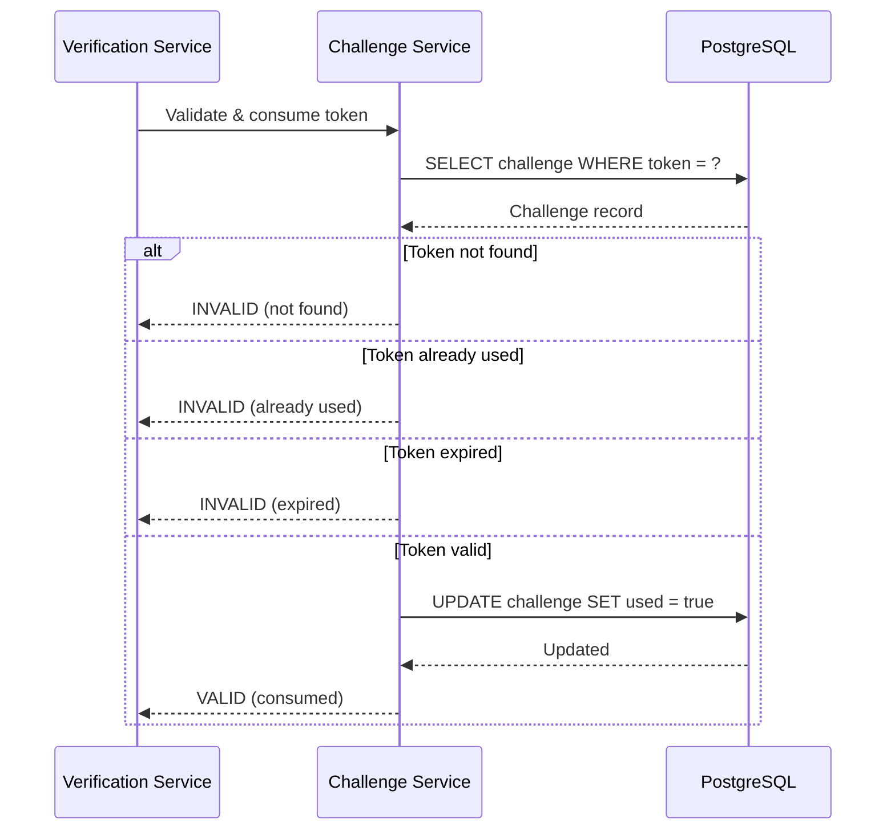

---

## 8. Voiceprint Revocation Flow

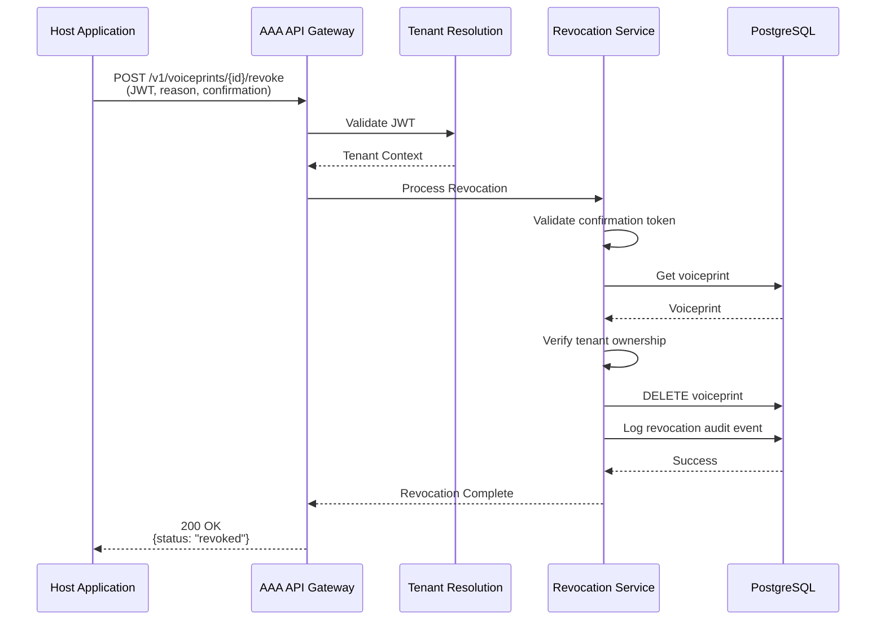

---

## 9. Health Check Flow

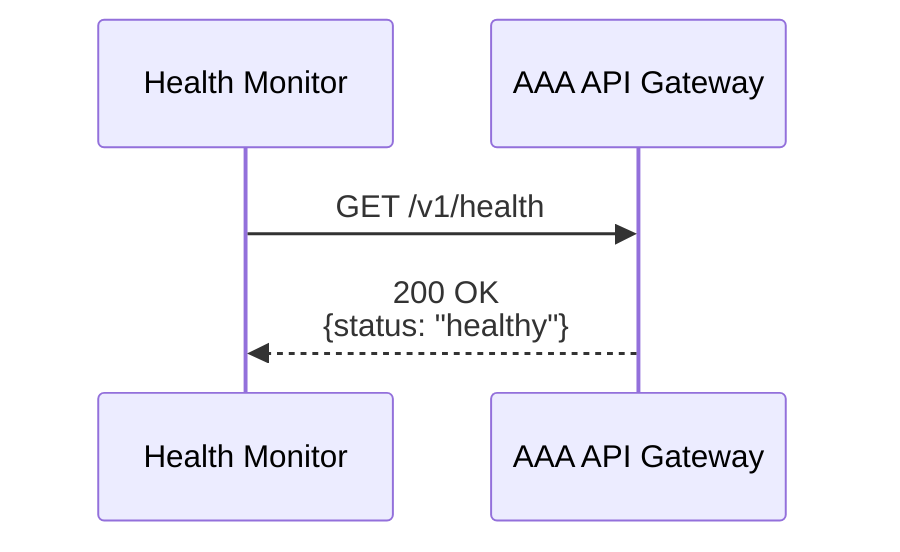

---

## 10. Readiness Check Flow

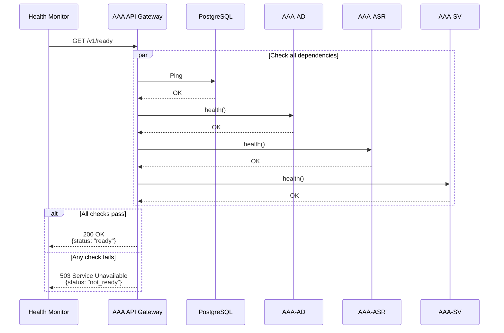

---

## 11. EMA Voiceprint Update Flow

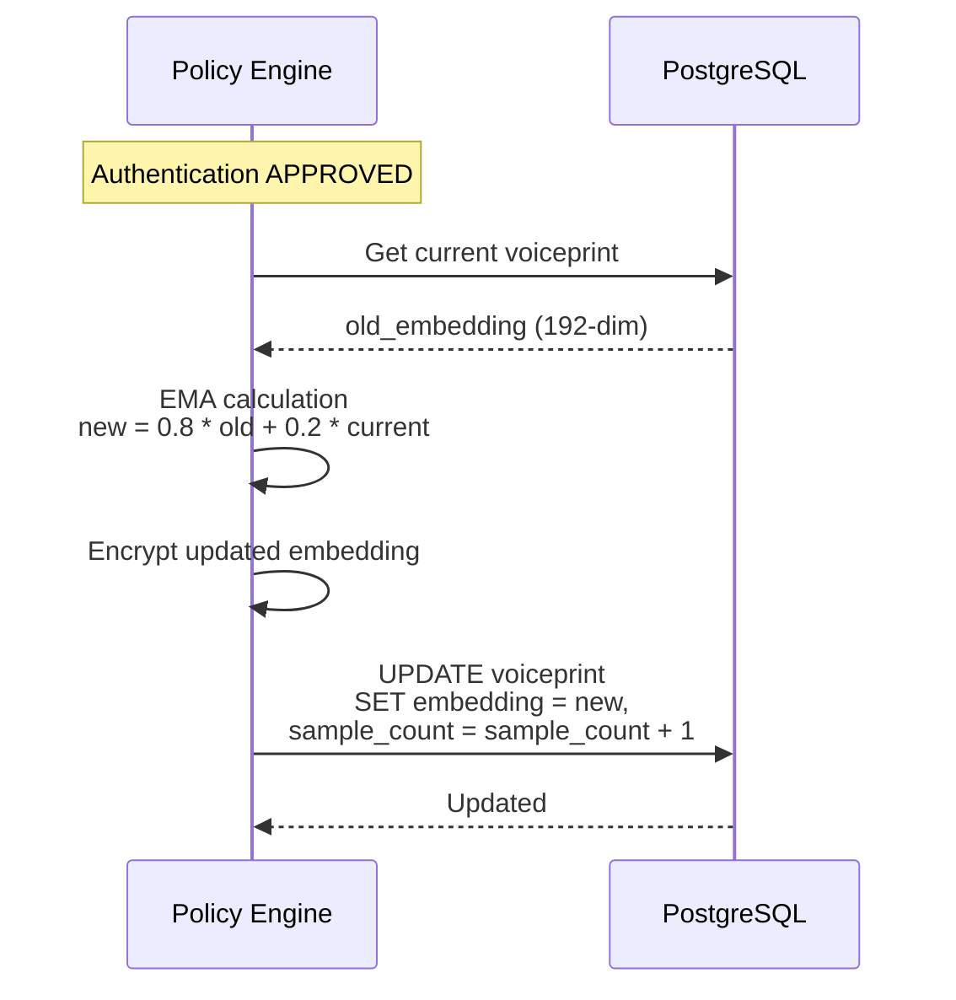

---

## 12. Error Handling Flow

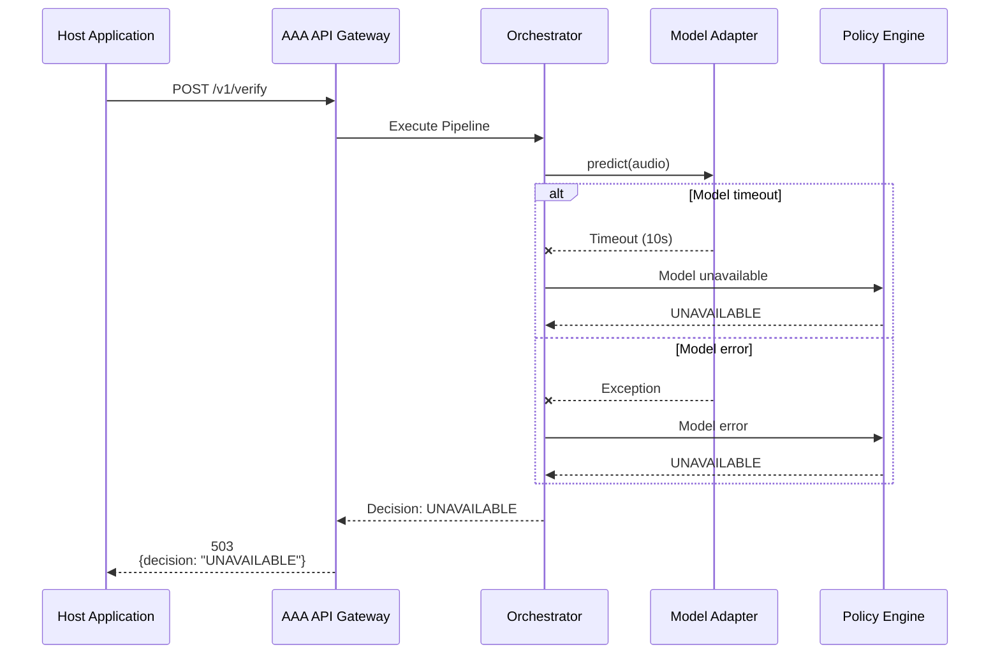

---

## State Diagrams

### Challenge State Machine

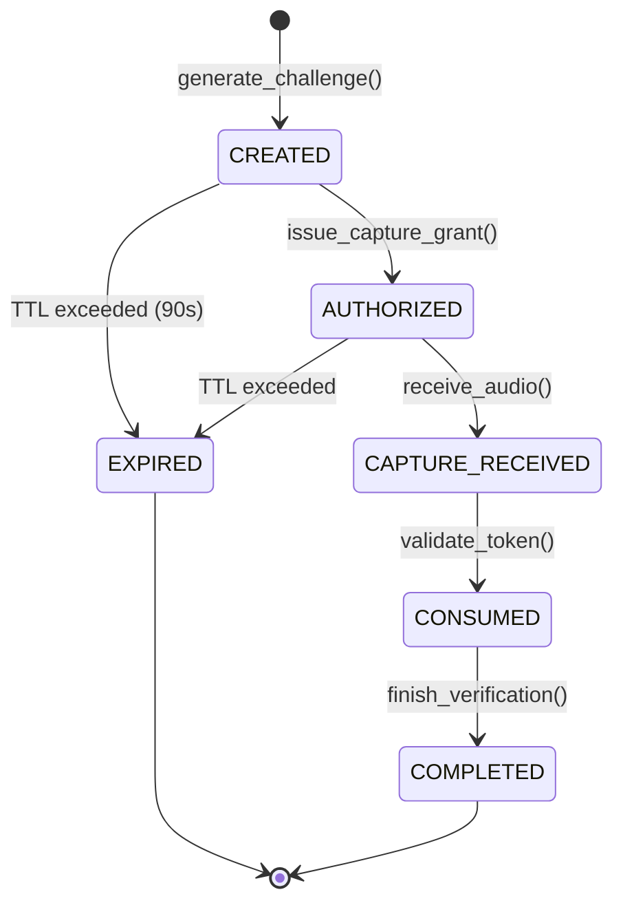

### Verification Request State Machine

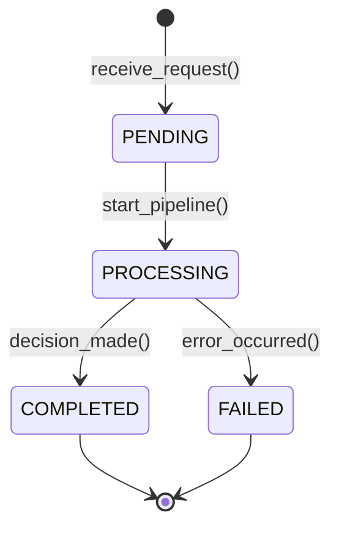

---

**Document Version:** 1.0
**Classification:** Architecture Documentation
